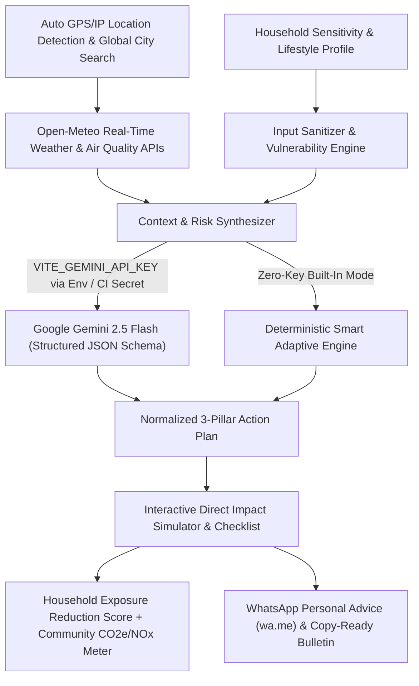

# AeroShield AI — Urban Air Quality & Winter Smog Assistant

> **PromptWars [Challenge 6]: Urban Air Quality Assistant**

**AeroShield AI** is a lightweight, production-ready GenAI assistant built for urban families navigating severe winter smog and thermal inversion episodes. It combines automatic GPS/IP location detection, live Open-Meteo real-time weather & AQI telemetry, a manual winter smog simulator, household sensitivity profiling, Google Gemini (`gemini-2.5-flash`) structured JSON generation, a built-in **Smart Adaptive Engine**, and direct **WhatsApp personalized advice**—while explicitly quantifying the **health and emission impact** of every recommendation.

---

## 1. Chosen Vertical & Target Persona

- **Hackathon Vertical:** `[Challenge 6] Urban Air Quality Assistant`
- **Target Persona:** Urban families (including infants/children, elderly relatives, asthma/respiratory-sensitive members, pets, and daily commuters) living in high-AQI cities prone to winter thermal inversions.
- **Core Problem Solved:** Conventional AQI dashboards report raw numbers without answering what matters to a household: *What is the real-time weather & inversion risk right here in my city? When is the brief safe window to ventilate? How do we protect vulnerable family members affordably indoors? And how can I get tailored advice straight on WhatsApp?*

---

## 2. System Architecture & Logical Decision-Making Flow

AeroShield AI uses a **hybrid deterministic + Generative AI architecture** for zero-friction evaluation, strict schema reliability, and WCAG AA accessibility.



### Logical Decision-Making Flow
1. **Universal Location Detection & Real-Time Weather + AQI (`src/services/airQualityService.js`):**
   - Automatically detects the user's city on load (silent IP geolocation fallback) and provides a one-click **Detect My Current Location (GPS / Auto)** button with reverse-geocoding (`BigDataCloud`), plus live typeahead search for any city, town, or district worldwide (`Open-Meteo Geocoding`).
   - Fetches real-time **Weather** (`temperature_2m`, `relative_humidity_2m`, `wind_speed_10m`, WMO condition) in parallel with **Air Quality** (`us_aqi`, `pm2_5`, `pm10`, `nitrogen_dioxide`, `ozone`, diurnal hourly trends).
2. **Household Vulnerability Profiling (`src/utils/impactCalculator.js`):** Computes a `1.0x–1.68x` household sensitivity multiplier from toggles (`Infants/Children`, `Elderly`, `Asthma/Respiratory`, `Pets`) and pairs it with commute mode, home ventilation setup, and cooking fuel.
3. **Structured GenAI Reasoning + Smart Adaptive Engine (`src/services/geminiService.js`):**
   - When `VITE_GEMINI_API_KEY` is supplied via `.env` or GitHub Actions secret (`secrets.GEMINI_API_KEY`), `gemini-2.5-flash` generates structured JSON strictly matching `ACTION_PLAN_SCHEMA`—with zero API key prompts exposed on the website UI.
   - Without any external key, the **Smart Adaptive Engine** dynamically tailors routines, IAQ hacks, and sustainable swaps to the exact weather, wind dispersion, AQI tier, and household profile.

---

## 3. How the Solution Works

### Key Capabilities
- **Any-Location Real-Time Weather & AQI:** Auto-detects user location or searches any city worldwide, displaying Temperature, Humidity, Wind Speed, Condition, US AQI, PM2.5, PM10, NO2, and diurnal inversion bars.
- **Low-Emission Daily Routine:** Time-blocked guidance (`06:00–10:00 Peak Inversion`, `10:00–13:00 Commute`, `13:30–15:30 Thermal Lift`, `18:30–22:30 Evening Lock`) aligned with winter boundary-layer physics.
- **DIY & Low-Cost IAQ Hacks:** Tailored steps including MERV-13 Corsi-Rosenthal box purifiers, HEPA placement, damp microfiber mopping vs dry sweeping, and foam weather-stripping.
- **Sustainable Alternatives:** Practical shifts covering metro/carpool commutes, zero-idling pledges, electric/induction cooking transitions, and zero outdoor leaf/waste burning.
- **Direct Impact Explainer & Interactive Checklist:** Every card displays quantified `-% PM2.5`, `-kg CO2e`, and `-g NOx` badges and rationale. Checking off actions updates the live **Household Exposure Reduction Score** and **Community Emission Savings** meter.
- **WhatsApp Personal Advice & Community Alert:** Users enter their WhatsApp phone number, choose an advisory format (*Full Family Plan*, *Daily Inversion Schedule*, or *Urgent Alert*), and click **Send to WhatsApp** to receive their customized weather + AQI advice directly via WhatsApp (`wa.me`), or copy the summary for neighborhood groups.

---

## 4. Direct Impact Calculation Methodology & Assumptions

### Quantitative Methodology (`src/utils/impactCalculator.js`)
1. **Diminishing-Returns Exposure Reduction Score:**
   Adopted actions combine multiplicatively rather than naively summing percentages:
   $$\text{Combined Reduction (\%)} = \min\left(92,\; 100 \times \left(1 - \prod_{i \in \text{Adopted}} \left(1 - \frac{r_i}{100}\right)\right)\right)$$
   where $r_i$ is each adopted recommendation's estimated PM2.5 inhalation reduction (`pm25ReductionPct`). The 92% cap reflects realistic residential infiltration limits.
2. **Effective Indoor PM2.5:** Computed from baseline ambient PM2.5 ($\mu\text{g/m}^3$) reduced by the combined score, floored at `4 µg/m³`.
3. **Community Emission Savings:** Daily `CO2e` (kg/day) and `NOx` smog-precursor savings (g/day) sum directly across adopted swaps, with a 30-day household projection and 1,000-household neighborhood scaling estimate.
4. **Simulated Pollutant Derivation:** When using the manual AQI simulator slider, `estimatePollutantsFromAqi(aqi)` inverts piecewise-linear US EPA PM2.5 AQI breakpoints to produce physically consistent PM2.5, PM10, and NO2 concentrations.

### Key Assumptions
- **Winter Thermal Inversion Timing:** Ground-level concentrations peak between `06:00–10:00` and `18:30–23:00` under cold boundary-layer compression and calm winds (`< 8 km/h`), with a dispersion window around `13:30–15:30`.
- **Engineering Baselines:** Impact estimates are grounded in standard indoor air quality and urban transport benchmarks (e.g., MERV-13/Corsi-Rosenthal filtration achieving ~48–52% indoor PM2.5 drop; shifting a ~14 km solo petrol car commute to transit saving ~2.4 kg CO2e/day and ~8.5 g NOx/day).
- **Zero-Secret Security:** API keys are never hardcoded in source control and never requested openly on the public UI; Gemini keys are configured solely via `.env` or GitHub Actions Repository Secrets (`GEMINI_API_KEY`).

---

## 5. Setup, Security & Testing Instructions

### Prerequisites
- Node.js `>= 18` and npm `>= 9`

### Local Setup
```bash
git clone <your-repo-url>
cd urban-air-quality-assistant
npm install
npm run dev
```

### Environment Configuration (Optional)
To enable live `gemini-2.5-flash` generation locally or in CI without exposing any key in the UI:
1. Locally: copy `.env.example` to `.env` (git-ignored) and set `VITE_GEMINI_API_KEY=your_key`.
2. On GitHub Pages: add `GEMINI_API_KEY` under **Repository Settings → Secrets and variables → Actions**; `.github/workflows/deploy.yml` injects it at build time.

### Running Automated Tests & Production Build
```bash
npm test
npm run build
```

### Project Structure
```text
src/
├── components/
│   ├── ActionPlanSection.jsx     # 3-pillar cards, adoption toggles & Direct Impact explainers
│   ├── AirQualityTelemetry.jsx   # Real-time weather, AQI metrics & diurnal inversion chart
│   ├── AqiBadge.jsx              # Color-blind-safe WCAG AA AQI severity badge
│   ├── CommunityShareCard.jsx    # WhatsApp number advisory dispatch + neighborhood bulletin
│   ├── HouseholdProfiler.jsx     # GPS/IP location detect, global city search & lifestyle inputs
│   └── ImpactDashboard.jsx       # Interactive Exposure Reduction & Emission Savings meters
├── services/
│   ├── airQualityService.js      # Open-Meteo Weather & AQI, Geocoding, Reverse-Geocode & IP geo
│   └── geminiService.js          # Gemini 2.5 Flash JSON Schema service + Smart Adaptive Engine
├── utils/
│   ├── impactCalculator.js       # AQI tiers, EPA breakpoints, impact math & WhatsApp formatter
│   └── sanitize.js               # Input sanitization, phone normalization & profile validation
└── test/
    ├── airQualityService.test.js
    ├── App.test.jsx
    ├── geminiService.test.js
    └── impactCalculator.test.js
```
